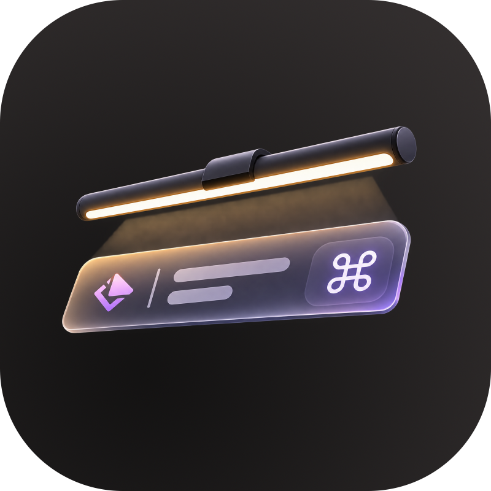

<p align="center">
  
</p>

# BenQ ScreenBar Lite — Native macOS CLI & Raycast Control

[English](./README.md) | [繁體中文](./README.zh-TW.md)

A 100% native Apple Silicon (`arm64`) CLI & **Raycast Script Commands** suite for the **BenQ ScreenBar Lite** laptop monitor lamp (`VID: 0x04A5`, `PID: 0x2500`), completely replacing BenQ's discontinued Intel-only (`x86_64`) macOS app.

---

## ✨ Features

- **100% Native Apple Silicon (`arm64`)**: Zero Rosetta 2 overhead, zero bloated background GUI.
- **Raycast Script Commands**: Instant keyboard shortcuts for Power Toggle, Brightness Up/Down, Color Temperature Warmer/Cooler, Auto-Dimming Mode, and Circadian Mode.
- **🌅 Circadian Mode**: Automatically shifts color temperature throughout the day (from `6500K` daylight focus in the morning down to `2700K` warm candlelight late at night). Manually adjusting color temperature automatically pauses Circadian Mode.
- **🌙 Sleep / Screen Lock / Shutdown Auto Power-Off**: Includes a lightweight native Objective-C daemon (`screenbar-power-monitor`) hooked into `IOKit`, `CoreGraphics`, and `NSWorkspace` that turns the lamp off immediately when your Mac sleeps, locks, or shuts down, and restores it upon wake — with **macOS `DarkWake` (Power Nap) filtering** so background maintenance wakes never turn on your lamp at night.
- **🔓 Reverse-Engineered USB HID Protocol**: Full documentation of the Weltrend MCU (`04A5:2500`) 9-byte HID report protocol, checksum algorithm, and internal outgoing FIFO queue behavior.

---

## ⚡ Resource Footprint

Compared to BenQ's official Qt-based Intel (`x86_64`) app running under Rosetta 2, this native solution uses virtually zero system resources:

| Metric | Official `BenQ ScreenBar Lite.app` | This Project (`screenbar-power-monitor` + LaunchAgents) |
| :--- | :---: | :---: |
| **Architecture** | Intel `x86_64` (Rosetta 2 translation) | **Native `arm64` (Apple Silicon)** |
| **CPU Usage** | `0.3% – 1.5%` (continuous USB polling) | **`0.0%`** (100% kernel event-driven via `CFRunLoop`, zero polling) |
| **RAM (`phys_footprint`)** | `~120 MB – 180 MB` | **`~7.0 MB` (`7,201 KB`)** |
| **Disk Size** | `~45 MB` (`.app` bundle + Qt frameworks) | **`~55 KB`** (compiled native binary + shell scripts) |
| **Circadian Worker** | Not supported | **`0 MB` resident** (triggered by `launchd` once every hour on the hour for `~50ms`, then exits) |

---

## 🚀 Installation

### Requirements

| Requirement | Details |
| :--- | :--- |
| **Hardware** | BenQ ScreenBar Lite (`04A5:2500`) connected to the Mac via USB |
| **OS** | macOS on Apple Silicon (`arm64`) |
| **Homebrew** | Used to install `hidapitester` ([install Homebrew](https://brew.sh)) |
| **Xcode Command Line Tools** | Provides `clang` to build the power monitor: `xcode-select --install` |
| **Raycast** | Optional, only needed for hotkey control ([raycast.com](https://www.raycast.com)) |

### 1. Clone & Run Installer

> [!IMPORTANT]
> The LaunchAgents reference the absolute path of this folder. Clone it to a **permanent location** (don't move or delete it afterwards, or re-run `./_install.sh` after moving).

```bash
git clone https://github.com/dryden/benq-screenbar-lite-raycast.git ~/benq-screenbar-lite
cd ~/benq-screenbar-lite
./_install.sh
```

What `_install.sh` does:
1. Installs [`hidapitester`](https://github.com/todbot/hidapitester) via Homebrew if not already installed.
2. Compiles [`screenbar-power-monitor.m`](./screenbar-power-monitor.m) into a native binary using system `clang`.
3. Installs and starts two user `LaunchAgents` (and removes the legacy `com.benq.*` ones from older versions):
   - `io.github.dryden.screenbar-circadian` (updates color temperature at the top of every hour when lamp is ON)
   - `io.github.dryden.screenbar-power-monitor` (turns lamp OFF on sleep/lock/shutdown and restores on wake)

The installer is safe to re-run at any time (e.g. after `git pull`); restarting the services does **not** turn the lamp off.

### 2. Add to Raycast

1. Open **Raycast** -> **Settings** (`⌘ ,`) -> **Extensions**.
2. Click **Add More** (`+`) -> **Add Script Directory**.
3. Select the folder you cloned to (e.g. `~/benq-screenbar-lite`).
4. Bind your favorite hotkeys to the 7 commands!

| Script File | Raycast Command Title | Description |
| :--- | :--- | :--- |
| `screenbar-toggle-power.sh` | **ScreenBar: Toggle Power** | Toggle lamp ON/OFF (re-applies circadian color temp on turn-on) |
| `screenbar-brightness-up.sh` | **ScreenBar: Brightness Up** | Increase brightness (`1`..`15`) |
| `screenbar-brightness-down.sh` | **ScreenBar: Brightness Down** | Decrease brightness (`1`..`15`) |
| `screenbar-temp-warmer.sh` | **ScreenBar: Temp Warmer** | Shift color temperature warmer towards `2700K` (pauses Circadian Mode) |
| `screenbar-temp-cooler.sh` | **ScreenBar: Temp Cooler** | Shift color temperature cooler towards `6500K` (pauses Circadian Mode) |
| `screenbar-toggle-auto.sh` | **ScreenBar: Toggle Auto Mode** | Toggle hardware ambient-light Auto-Dimming sensor |
| `screenbar-toggle-circadian.sh` | **ScreenBar: Toggle Circadian Mode** | Toggle automatic time-of-day color temperature |

### 3. Verify

```bash
launchctl list | grep screenbar          # should list the 2 io.github.dryden.* services
tail -3 /tmp/screenbar-power.log          # should end with "started and connected to WindowServer"
./screenbar-toggle-power.sh               # the lamp should toggle
```

Then lock your screen (`⌃⌘Q`): the lamp should turn off, and turn back on when you unlock.

### Update

```bash
cd ~/benq-screenbar-lite && git pull && ./_install.sh
```

### Uninstall

```bash
cd ~/benq-screenbar-lite
./_uninstall.sh            # stop and remove the background services
./_uninstall.sh --purge    # ...and also delete ~/.screenbar_lite_state and the logs
```

Then remove the script directory from Raycast and delete the cloned folder.

### Behavior Notes

- **Circadian Mode vs. Auto Mode:** while hardware Auto-Dimming (`Toggle Auto Mode`) is active, Circadian Mode does not override the lamp.
- **Manual color temperature** (`Temp Warmer` / `Temp Cooler`) pauses Circadian Mode until you toggle it on again.
- **State** is stored in `~/.screenbar_lite_state`; logs are in `/tmp/screenbar-power.log` and `/tmp/screenbar-circadian.log`.

### Troubleshooting

| Symptom | Fix |
| :--- | :--- |
| `device not responding, is it plugged in?` | Check the USB cable. The lamp must be connected directly or through a data-capable hub. |
| `device is stuck (FIFO full), unplug and replug the USB cable` | The lamp's MCU is ignoring commands (`C3 1F`). Unplug the USB cable, wait 5 seconds, plug it back in. |
| `clang not found` during install | Run `xcode-select --install`, then re-run `./_install.sh`. |
| Lamp doesn't react to sleep / wake | Check `/tmp/screenbar-power.log` and that `launchctl list \| grep screenbar` shows both services. |
| Raycast doesn't list the commands | Make sure the script directory is added in Raycast settings and the scripts are executable (`chmod +x *.sh`). |

---

## 🔬 Reverse-Engineered USB HID Protocol

### Hardware Identifiers
- **Vendor ID (`idVendor`)**: `0x04A5` (`1189`, Acer / BenQ / Weltrend)
- **Product ID (`idProduct`)**: `0x2500` (`9472`)
- **Product String**: `"HID Bridge"`
- **Manufacturer String**: `"Weltrend Semiconductor, Inc."`

### Output Report Format (`SET_REPORT` / `hid_write`)
All host-to-device commands are **9 bytes** (including prepend Report ID `0x00`, followed by an 8-byte payload `[B0..B7]`):

| Command | Official Symbol | 9-Byte Hex Payload (`ReportID` + 8 Bytes) | Notes |
| :--- | :--- | :--- | :--- |
| **Power ON** | `sbPowerOn` | `00 A7 FF FF FF FF 02 FF A4` | Turns lamp ON |
| **Power OFF** | `sbPowerOff` | `00 A7 FF FF FF FF 01 FF A3` | Turns lamp OFF |
| **Manual Mode** | `sbChangeMode(1)` | `00 A7 FF FF FF 01 02 FF A6` | Switches to manual mode |
| **Auto Dimming Mode** | `sbChangeMode(2)` | `00 A7 FF 05 FF 02 02 FF AD` | Enables ambient light sensor auto mode |
| **Favorite Mode** | `sbChangeMode(3)` | `00 A7 FF FF FF 03 02 FF A8` | Loads hardware favorite preset |
| **Set Brightness & Temp** | `setSBBrightness` / `setSBColorTemp` | `00 A7 <B> <T> FF 04 02 FF <CK>` | `<B>`: `0x01`..`0x0F` (1..15)<br>`<T>`: `0x01`..`0x08` (hardware: `6500K`..`2700K`, see below)<br>`<CK>`: Checksum (see below) |
| **Query Device Status** | `getHidDevice` | `00 B3 53 FF FF FF FF FF 01` | Returns 8-byte status Input Report `57 ...` |
| **Firmware Reset** ⚠️ | `sbFwReset` | `00 A3 04 FF FF FF FF FF A2` | **DO NOT SEND** in normal operation (locks MCU into bootloader mode until USB power cycle) |

#### Color Temperature Index (`<T>`)
The Index column is the logical index used by the scripts (`1` = warmest). The Hex column is what the lamp actually expects: **hardware index is inverted** (`0x01` = `6500K`, `0x08` = `2700K`), and `send_brightness_temp` converts with `9 - index`.

| Index | Hex | Color Temperature |
| :---: | :---: | :---: |
| `1` | `0x08` | `2700K` (Warmest) |
| `2` | `0x07` | `3000K` |
| `3` | `0x06` | `3500K` |
| `4` | `0x05` | `4000K` |
| `5` | `0x04` | `4500K` |
| `6` | `0x03` | `5000K` |
| `7` | `0x02` | `5700K` |
| `8` | `0x01` | `6500K` (Coolest) |

#### Checksum Formula (`<CK>`)
The final byte (`B7`) is the low 8-bit sum of bytes `B0..B6`:
```python
checksum = (B0 + B1 + B2 + B3 + B4 + B5 + B6) & 0xFF
# For Set Brightness (B) & Color Temp (T) where B0=0xA7, B3=0xFF, B4=0x04, B5=0x02, B6=0xFF:
checksum = (0xA7 + B + T + 0xFF + 0x04 + 0x02 + 0xFF) & 0xFF
```

### Input Report & Critical Weltrend MCU FIFO Queue Behavior ⚠️
Every time the host sends an Output Report (`0xA7` or `0xB3`), the Weltrend MCU pushes an 8-byte response into its internal outgoing FIFO buffer:
- **Command ACK**: `00 C3 0F FF FF FF FF FF CD`
- **Status Response (to `00 B3 53 ...`)**: `00 57 <B> <T> <AMB> <MODE> <POWER> FF <CK>` (where `POWER` is `0x01` = OFF, `0x02` = ON)
- **FIFO Full / NACK**: `00 C3 1F FF FF FF FF FF DD`

> [!IMPORTANT]
> **Always pop the Input Report after sending a command!**
> If the host only writes Output Reports (`--send-output`) without reading back the Input Report (`--read-input-report 0`), the MCU's internal outgoing FIFO queue fills up after ~6–8 commands, starts returning `C3 1F`, and ignores subsequent commands. Once stuck, only a USB power cycle (unplug / replug) recovers it; the scripts detect `C3 1F` and tell you so.
>
> In [`_screenbar_lib.sh`](./_screenbar_lib.sh), every command automatically drains the FIFO:
> ```bash
> hidapitester --vidpid 04A5:2500 --quiet --open \
>   --length 9 --send-output "$packet" \
>   --timeout 40 --length 8 --read-input \
>   --length 9 --read-input-report 0 \
>   --close
> ```

---

## 🌅 Circadian Schedule

You can customize the hourly schedule in [`_screenbar_lib.sh`](./_screenbar_lib.sh) (`get_circadian_temp`):

| Time Window | Color Temp | Index | Description |
| :--- | :---: | :---: | :--- |
| `07:00 – 07:59` | `4000K` | `4` | Morning soft warm light |
| `08:00 – 08:59` | `5000K` | `6` | Morning wake-up light |
| `09:00 – 11:59` | `6500K` | `8` | High-focus cool daylight |
| `12:00 – 15:59` | `5700K` | `7` | Natural afternoon daylight |
| `16:00 – 17:59` | `5000K` | `6` | Comfortable late-afternoon light |
| `18:00 – 19:59` | `4000K` | `4` | Evening warm transition |
| `20:00 – 21:59` | `3500K` | `3` | Nighttime relaxing warm light |
| `22:00 – 22:59` | `3000K` | `2` | Pre-sleep warm yellow light |
| `23:00 – 06:59` | `2700K` | `1` | Late-night candlelight |

---

## 📝 Release Notes

### 2026-11-08 — Reliable Auto Power-Off on Shutdown / Restart / Logout
- **Fixed lamp staying on after shutting down the Mac**: Previously, when macOS shut down or restarted, the background service exited immediately upon receiving system termination signals before it could turn the lamp off. It now properly intercepts macOS shutdown, restart, and logout events (`IOKit` power-off/restart notifications, Cocoa app termination hooks, and `launchd` stop signals) to turn the lamp off first.
- **No flicker when updating/reinstalling**: Re-running `./_install.sh` to update the service still restarts the background monitor cleanly without turning your lamp off.

---

## ☕ Support

If this project saved your BenQ ScreenBar Lite on Apple Silicon, feel free to buy me a coffee!

[](https://buymeacoffee.com/dry4514)

---

## 📄 License

[MIT License](./LICENSE)

---

## ⚠️ Disclaimer

* **Unofficial Project**: This is an independent, third-party open-source project and is in no way affiliated with, authorized, maintained, sponsored, or endorsed by BenQ Corporation. "BenQ" and "ScreenBar" are registered trademarks of BenQ Corporation.
* **Use at Your Own Risk**: This tool communicates directly with the lamp's hardware controller via reverse-engineered USB HID payloads. It is provided "AS IS" without warranty of any kind. The author shall not be held liable for any hardware malfunction, erratic behavior, or voided warranty resulting from the use of this software.
* **Hardware Reset**: If the light bar becomes unresponsive after receiving a command, simply unplug the USB cable, wait 5 seconds, and plug it back in to power-cycle the controller.

