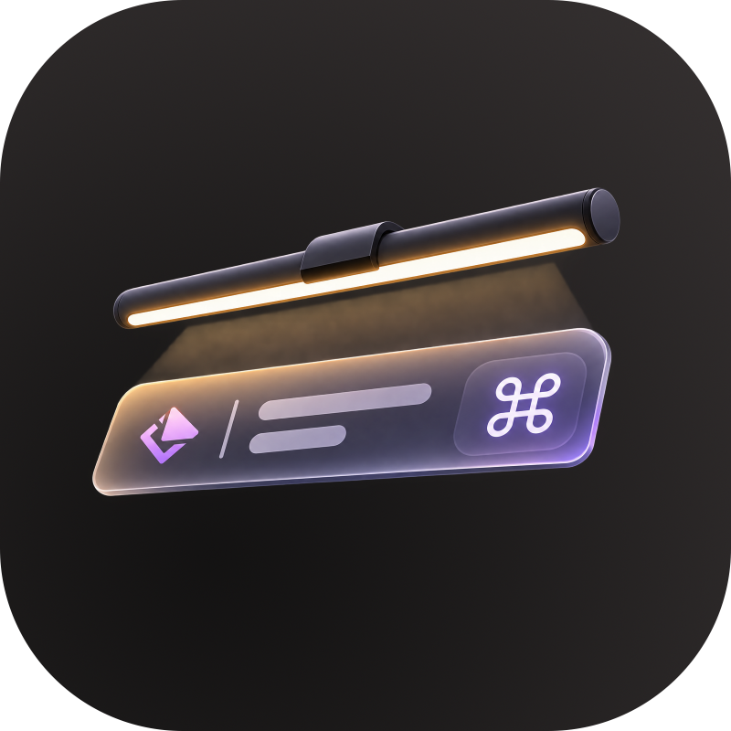

<p align="center">
  
</p>

# BenQ ScreenBar Lite — macOS 原生命令列與 Raycast 控制套件

[English](./README.md) | [繁體中文](./README.zh-TW.md)

專為 **BenQ ScreenBar Lite** 筆電螢幕掛燈（`VID: 0x04A5`, `PID: 0x2500`）打造的 100% 原生 Apple Silicon (`arm64`) 命令列與 **Raycast Script Commands** 控制套件，結合極輕量的原生 Objective-C 電源事件守護程式，徹底取代明基官方早已停止維護的 Intel (`x86_64`) 版 `BenQ ScreenBar Lite.app`。

---

## ✨ 功能特色

- **100% 原生 Apple Silicon (`arm64`)**：零 Rosetta 2 轉譯損耗，不需在背景掛載肥大的舊版 Qt 圖形介面。
- **Raycast Script Commands 快捷鍵控制**：一鍵控制電源開關、亮度增減（15 段）、色溫冷暖（8 段）、自動環境光感應模式與日夜節律模式。
- **🌅 日夜節律自動色溫（Circadian Mode）**：隨一天當中的時間自動平滑切換色溫（上午 `6500K` 專注白光、下午自然光、深夜自動降為 `2700K` 極暖燭光）。手動調整色溫時會自動暫停節律模式。
- **🌙 睡眠 / 鎖定螢幕 / 關機自動關燈**：內建純原生 Objective-C 守護程式（[`screenbar-power-monitor.m`](./screenbar-power-monitor.m)），直接監聽 macOS `IOKit`、`CoreGraphics` 與 `NSWorkspace` 系統事件，在電腦睡眠、鎖屏或關機瞬間自動熄燈，並在喚醒時自動恢復開燈——同時內建 **macOS `DarkWake`（Power Nap 背景小憩）過濾機制**，防止半夜系統背景維護時誤開掛燈。
- **🔓 完整公開逆向解析之 USB HID 通訊協定**：詳細記錄 Weltrend 晶片（`04A5:2500`）的 9-byte HID 控制封包、Checksum 演算法與晶片內部回應佇列（FIFO Queue）機制。

---

## ⚡ 系統常駐資源消耗（實測對比）

與明基官方透過 Rosetta 2 轉譯、使用舊版 Qt 框架打包的 `BenQ ScreenBar Lite.app` 相比，本專案的系統資源消耗幾乎為零：

| 指標項目 | 官方 `BenQ ScreenBar Lite.app` | 本專案 (`screenbar-power-monitor` + LaunchAgents) |
| :--- | :---: | :---: |
| **執行架構** | Intel `x86_64`（需透過 Rosetta 2 轉譯） | **原生 `arm64`（Apple Silicon）** |
| **CPU 佔用率** | `0.3% – 1.5%`（背景持續輪詢 USB） | **`0.0%`**（100% 透過 `CFRunLoop` 系統事件驅動，零輪詢） |
| **實體記憶體 (`phys_footprint`)** | `~120 MB – 180 MB` | **`~7.0 MB` (`7,201 KB`)** |
| **磁碟佔用大小** | `~45 MB`（`.app` 封裝與 Qt 函式庫） | **`~55 KB`**（編譯後原生執行檔 + Shell 腳本） |
| **日夜節律排程** | 不支援 | **常駐 `0 MB`**（由 `launchd` 每小時整點觸發執行約 `50ms` 即退出） |

---

## 🚀 安裝方式

### 系統需求

| 項目 | 說明 |
| :--- | :--- |
| **硬體** | 以 USB 連接到 Mac 的 BenQ ScreenBar Lite（`04A5:2500`） |
| **作業系統** | Apple Silicon (`arm64`) 的 macOS |
| **Homebrew** | 用來安裝 `hidapitester`（[安裝 Homebrew](https://brew.sh)） |
| **Xcode Command Line Tools** | 提供編譯守護程式所需的 `clang`：`xcode-select --install` |
| **Raycast** | 選用，僅在使用快捷鍵控制時需要（[raycast.com](https://www.raycast.com)） |

### 1. 下載並執行一鍵安裝腳本

> [!IMPORTANT]
> LaunchAgents 會記錄本資料夾的絕對路徑，請將專案下載到**固定位置**（之後不要移動或刪除；若移動，請重新執行 `./_install.sh`）。

```bash
git clone https://github.com/dryden/benq-screenbar-lite-raycast.git ~/benq-screenbar-lite
cd ~/benq-screenbar-lite
./_install.sh
```

`_install.sh` 會自動完成以下設定：
1. 檢查並透過 Homebrew 安裝原生 `arm64` 版的 [`hidapitester`](https://github.com/todbot/hidapitester)。
2. 使用系統內建的 `clang` 將 [`screenbar-power-monitor.m`](./screenbar-power-monitor.m) 編譯為原生執行檔。
3. 自動產生並載入兩個使用者層級的 `LaunchAgents`（同時清除舊版遺留的 `com.benq.*` 服務）：
   - `io.github.dryden.screenbar-circadian`（開燈狀態下每小時整點自動依據時段更新色溫）
   - `io.github.dryden.screenbar-power-monitor`（監聽睡眠、鎖屏與關機事件自動關燈，喚醒時自動開燈）

安裝腳本可以隨時重複執行（例如 `git pull` 之後），重啟服務**不會**讓燈熄滅。

### 2. 加入 Raycast

1. 打開 **Raycast** -> **Settings** (`⌘ ,`) -> **Extensions**。
2. 點選 **Add More** (`+`) -> **Add Script Directory**。
3. 選擇你下載專案的資料夾（例如 `~/benq-screenbar-lite`）。
4. 為以下 7 個指令綁定順手的快捷鍵即可！

| 腳本檔案 | Raycast 指令名稱 | 功能說明 |
| :--- | :--- | :--- |
| `screenbar-toggle-power.sh` | **ScreenBar: Toggle Power** | 切換電源開關（開燈時若開啟節律模式會自動套用當下時段色溫） |
| `screenbar-brightness-up.sh` | **ScreenBar: Brightness Up** | 調高亮度（`1`..`15` 共 15 段） |
| `screenbar-brightness-down.sh` | **ScreenBar: Brightness Down** | 調低亮度（`1`..`15` 共 15 段） |
| `screenbar-temp-warmer.sh` | **ScreenBar: Temp Warmer** | 色溫調暖（往 `2700K` 方向，並自動暫停日夜節律模式） |
| `screenbar-temp-cooler.sh` | **ScreenBar: Temp Cooler** | 色溫調冷（往 `6500K` 方向，並自動暫停日夜節律模式） |
| `screenbar-toggle-auto.sh` | **ScreenBar: Toggle Auto Mode** | 切換硬體環境光感應自動補光模式 |
| `screenbar-toggle-circadian.sh` | **ScreenBar: Toggle Circadian Mode** | 開關「日夜節律自動色溫」並立即套用當下時段色溫 |

### 3. 驗證安裝

```bash
launchctl list | grep screenbar          # 應看到 2 個 io.github.dryden.* 服務
tail -3 /tmp/screenbar-power.log          # 結尾應為 "started and connected to WindowServer"
./screenbar-toggle-power.sh               # 燈應該會切換開關
```

接著鎖定螢幕（`⌃⌘Q`）：燈應該熄滅，解鎖後自動亮起。

### 更新

```bash
cd ~/benq-screenbar-lite && git pull && ./_install.sh
```

### 解除安裝

```bash
cd ~/benq-screenbar-lite
./_uninstall.sh            # 停止並移除背景服務
./_uninstall.sh --purge    # 並一併刪除 ~/.screenbar_lite_state 與 log
```

之後從 Raycast 移除腳本目錄，並刪除下載的資料夾即可。

### 行為說明

- **節律模式與自動調光模式：** 硬體自動調光（`Toggle Auto Mode`）啟用期間，日夜節律模式不會覆蓋燈的設定。
- **手動調整色溫**（`Temp Warmer` / `Temp Cooler`）會暫停節律模式，直到你再次開啟。
- **狀態檔**位於 `~/.screenbar_lite_state`；log 位於 `/tmp/screenbar-power.log` 與 `/tmp/screenbar-circadian.log`。

### 疑難排解

| 症狀 | 解法 |
| :--- | :--- |
| `device not responding, is it plugged in?` | 檢查 USB 線。燈必須直接連接，或經由支援資料傳輸的 hub。 |
| `device is stuck (FIFO full), unplug and replug the USB cable` | 燈的 MCU 不再接受指令（回傳 `C3 1F`）。拔掉 USB 線，等 5 秒後再插回去。 |
| 安裝時出現 `clang not found` | 執行 `xcode-select --install`，再重新執行 `./_install.sh`。 |
| 睡眠 / 喚醒時燈沒有反應 | 查看 `/tmp/screenbar-power.log`，並確認 `launchctl list \| grep screenbar` 有列出兩個服務。 |
| Raycast 找不到指令 | 確認已在 Raycast 設定中加入腳本目錄，且腳本有執行權限（`chmod +x *.sh`）。 |

---

## 🔬 USB HID 硬體通訊協定解析

### 硬體識別資訊
- **Vendor ID (`idVendor`)**：`0x04A5`（`1189`）
- **Product ID (`idProduct`)**：`0x2500`（`9472`）
- **Product 名稱**：`"HID Bridge"`
- **Manufacturer 名稱**：`"Weltrend Semiconductor, Inc."`

### Output Report 控制封包格式（`SET_REPORT` / `hid_write`）
所有由電腦發送給燈具的指令皆為 **9 bytes**（第 1 個 byte 為 Report ID `0x00`，後接 8-byte Payload `[B0..B7]`）：

| 控制項目 | 官方內部函式名稱 | 9-Byte Hex 封包 (`ReportID` + 8 Bytes) | 說明 |
| :--- | :--- | :--- | :--- |
| **開啟電源** | `sbPowerOn` | `00 A7 FF FF FF FF 02 FF A4` | 點亮掛燈 |
| **關閉電源** | `sbPowerOff` | `00 A7 FF FF FF FF 01 FF A3` | 關閉掛燈 |
| **手動模式** | `sbChangeMode(1)` | `00 A7 FF FF FF 01 02 FF A6` | 切換為一般手動調光模式 |
| **自動調光模式** | `sbChangeMode(2)` | `00 A7 FF 05 FF 02 02 FF AD` | 啟用環境光感測器自動調光 |
| **我的最愛模式** | `sbChangeMode(3)` | `00 A7 FF FF FF 03 02 FF A8` | 讀取燈具內建的最愛記憶設定 |
| **設定亮度與色溫** | `setSBBrightness` / `setSBColorTemp` | `00 A7 <B> <T> FF 04 02 FF <CK>` | `<B>`：`0x01`..`0x0F`（亮度 1..15）<br>`<T>`：`0x01`..`0x08`（硬體定義：`6500K`..`2700K`，見下表）<br>`<CK>`：Checksum 校驗碼（見下方公式） |
| **查詢燈具狀態** | `getHidDevice` | `00 B3 53 FF FF FF FF FF 01` | 回傳 8-byte 狀態報告 `57 ...` |
| **韌體更新重置** ⚠️ | `sbFwReset` | `00 A3 04 FF FF FF FF FF A2` | **日常切勿發送**（會使晶片進入韌體更新模式並停止回應，需重新插拔 USB 才能恢復） |

#### 色溫對照表（`<T>`）
「Index」欄是腳本使用的邏輯索引（`1` = 最暖），「Hex」欄才是燈實際接受的值：**硬體索引是反向的**（`0x01` = `6500K`、`0x08` = `2700K`），`send_brightness_temp` 會以 `9 - index` 轉換。

| 編號 | Hex 值 | 對應色溫 |
| :---: | :---: | :---: |
| `1` | `0x08` | `2700K`（最暖黃光） |
| `2` | `0x07` | `3000K` |
| `3` | `0x06` | `3500K` |
| `4` | `0x05` | `4000K` |
| `5` | `0x04` | `4500K` |
| `6` | `0x03` | `5000K` |
| `7` | `0x02` | `5700K` |
| `8` | `0x01` | `6500K`（最冷白光） |

#### Checksum 校驗碼公式（`<CK>`）
最後一個 byte（`B7`）為前面 `B0..B6` 加總後的最低 8-bit 值（`& 0xFF`）：
```python
checksum = (B0 + B1 + B2 + B3 + B4 + B5 + B6) & 0xFF
# 以設定亮度 (B) 與色溫 (T) 為例（固定 B0=0xA7, B3=0xFF, B4=0x04, B5=0x02, B6=0xFF）：
checksum = (0xA7 + B + T + 0xFF + 0x04 + 0x02 + 0xFF) & 0xFF
```

### Input Report 與 Weltrend 晶片內部佇列（FIFO Queue）注意事項 ⚠️
每當主機發送一筆 Output Report（`0xA7` 或 `0xB3`）時，燈具內的 Weltrend 晶片都會往內部的傳出緩衝佇列（Outgoing FIFO Buffer）塞入一筆 8-byte 回應：
- **一般指令 ACK**：`00 C3 0F FF FF FF FF FF CD`
- **狀態查詢回應（對應 `00 B3 53 ...`）**：`00 57 <B> <T> <AMB> <MODE> <POWER> FF <CK>`（其中 `POWER` 為 `0x01` 代表關燈、`0x02` 代表開燈）
- **佇列滿載錯誤（FIFO Full / NACK）**：`00 C3 1F FF FF FF FF FF DD`

> [!IMPORTANT]
> **發送指令後務必同步讀取（Pop）Input Report！**
> 若只單向發送 Output Report（`--send-output`）而沒有讀取 Input Report（`--read-input-report 0`），累積約 6～8 次指令後晶片內部的回應佇列就會塞滿（回傳 `C3 1F`），導致燈具不再執行後續指令。一旦卡住，只有拔插 USB 重新供電才能恢復；腳本偵測到 `C3 1F` 時會直接提示。
>
> 在 [`_screenbar_lib.sh`](./_screenbar_lib.sh) 中，每次發送指令都會自動將佇列清空：
> ```bash
> hidapitester --vidpid 04A5:2500 --quiet --open \
>   --length 9 --send-output "$packet" \
>   --timeout 40 --length 8 --read-input \
>   --length 9 --read-input-report 0 \
>   --close
> ```

---

## 🌅 日夜節律色溫時間表

你可以在 [`_screenbar_lib.sh`](./_screenbar_lib.sh) 的 `get_circadian_temp` 函式中自由調整各時段的對應色溫：

| 時段 | 自動色溫 | 色溫檔位 | 情境說明 |
| :--- | :---: | :---: | :--- |
| `07:00 – 07:59` | `4000K` | `4` | 晨間柔和暖白光 |
| `08:00 – 08:59` | `5000K` | `6` | 早晨清醒自然光 |
| `09:00 – 11:59` | `6500K` | `8` | 上午高專注冷白光 |
| `12:00 – 15:59` | `5700K` | `7` | 午後自然日光 |
| `16:00 – 17:59` | `5000K` | `6` | 下午舒適光 |
| `18:00 – 19:59` | `4000K` | `4` | 傍晚微暖過渡光 |
| `20:00 – 21:59` | `3500K` | `3` | 夜間放鬆暖光 |
| `22:00 – 22:59` | `3000K` | `2` | 睡前準備暖黃光 |
| `23:00 – 06:59` | `2700K` | `1` | 深夜極暖燭光 |

---

## ☕ 贊助支持

如果這個專案拯救了你在 Apple Silicon Mac 上的 BenQ ScreenBar Lite，歡迎請我喝杯咖啡！

[](https://buymeacoffee.com/dry4514)

---

## 📄 授權條款

[MIT License](./LICENSE)

---

## ⚠️ 免責聲明與注意事項 (Disclaimer)

* **非官方專案 (Unofficial Project)**：本專案為獨立開發的第三方開源工具，與明基電通 (BenQ Corporation) 無任何附屬、授權、背書或官方合作關係。「BenQ」與「ScreenBar」皆為該公司之註冊商標。
* **硬體風險自負 (Use at Your Own Risk)**：本工具透過逆向工程解析之 USB HID 封包直接與燈具微控制器 (MCU) 進行底層通訊。雖然已經過實機測試，但不同硬體批次或韌體版本可能存在差異。使用本腳本控制硬體之風險由使用者自行承擔，開發者不對任何潛在的硬體異常、設定跑掉、韌體損壞或保固失效負責。
* **異常排除 (Troubleshooting)**：若發送指令後燈具出現無反應或控制異常，請直接拔除 ScreenBar Lite 的 USB 電源線並靜置 5 秒後重新插上，即可重置燈具內部的微控制器狀態。

